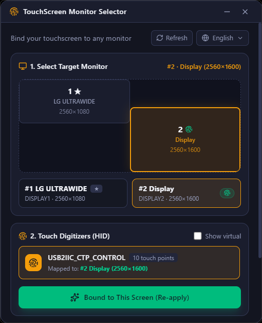

<p align="center">
  
</p>

<h1 align="center">TouchScreen Monitor Selector</h1>

<p align="center">
  A lightweight Windows desktop application to bind any HID touch screen digitizer to any target display with a single click.
  <br />
  Built with <strong>Tauri v2</strong>, <strong>Rust</strong>, <strong>React 19</strong>, and <strong>Tailwind CSS v4</strong>.
</p>

<p align="center">
  
</p>

<p align="center">
  <a href="https://github.com/alexwing/TouchScreenMonitorSelector/releases/latest">
    
  </a>
  <a href="LICENSE">
    
  </a>
  
</p>

---

## Overview

In multi-monitor setups on Windows, touch input from external or secondary touch displays is often incorrectly routed to the primary monitor or mapped to the wrong screen. Windows does not provide a straightforward, accessible UI setting to fix this behavior without digging through legacy Control Panel wizards.

**TouchScreen Monitor Selector** solves this with an intuitive, modern interface that detects all connected displays and HID touch digitizers, remapping touch input to your chosen monitor in real time without requiring a system reboot or sign-out.

---

## Features

- **Proportional Visual Monitor Layout**: Renders an interactive, proportional canvas of your multi-monitor desktop layout matching actual Windows display coordinates, dimensions, and real EDID monitor names (e.g. `LG ULTRAWIDE`, `Display`).
- **Active Touch Indicator**: Highlights which monitor currently receives input with a fingerprint badge.
- **Automatic HID Digitizer Detection**: Enumerates active touch devices and pens via Windows Raw Input and Pointer APIs (Usage Page `0x0D`), displaying product details, vendor/product IDs (`VID:PID`), and maximum concurrent touch points.
- **Real-Time Win32k Input Remapping**:
  - Dynamically invokes the undocumented `USER32.dll` pointer management API (Ordinal `#2532`) to immediately redirect active touch coordinates to the target `HMONITOR` in the kernel without restarting.
  - Persists the mapping to `HKEY_LOCAL_MACHINE\SOFTWARE\Microsoft\Wisp\Pen\Digimon` and broadcasts `WM_SETTINGCHANGE` (`TabletPCDigitizerMappingChanged`) so your preferences persist across reboots.
  - Automatic on-demand UAC elevation helper if running without administrator privileges.
- **Quick Access to Windows Native Tools**: Optional direct launchers for built-in utilities:
  - `MultiDigiMon.exe -touch` (Windows Native Tablet PC Display Configuration Wizard)
  - `tabcal.exe devicekind=touch` (Windows Native Touch Calibration Tool)
- **Windows 11 Native Aesthetic**: Frameless, transparent dark-mode titlebar, system tray integration with active status indicator, single-instance protection, and multilingual support (**English**, **Spanish**, **French**, **German**, and **Japanese**).

---

## Architecture & How It Works

Windows internally manages touch-to-monitor associations through the Tablet PC subsystem (`Wisp`):

```
+-------------------------------------------------------------+
|                      React 19 Frontend                      |
|         (Monitor Grid Canvas + Touch Device List)           |
+------------------------------+------------------------------+
                               | invoke("bind_touch_to_monitor")
                               v
+-------------------------------------------------------------+
|                     Rust Backend (Tauri v2)                 |
|                                                             |
|  1. Immediate Hot Re-bind:                                  |
|     USER32.dll Ordinal #2532 (Pointer Device -> HMONITOR)   |
|                                                             |
|  2. Registry Persistence:                                   |
|     HKLM\SOFTWARE\Microsoft\Wisp\Pen\Digimon               |
|                                                             |
|  3. System Broadcast:                                       |
|     SendMessageTimeoutW(HWND_BROADCAST, WM_SETTINGCHANGE)   |
+-------------------------------------------------------------+
```

1. **Live Binding**: Calls `USER32.dll` Ordinal `#2532`, passing `(HANDLE pointerDevice, HMONITOR targetMonitor)`. This updates the active session mapping immediately in the Windows kernel (`win32k`).
2. **Registry Storage**: Writes `20-\\?\HID#...` with the monitor's device interface path into `HKLM\SOFTWARE\Microsoft\Wisp\Pen\Digimon`.
3. **Notification**: Broadcasts `TabletPCDigitizerMappingChanged` so background services refresh their state.

---

## Installation

Download the latest installer or portable executable from the [Releases page](https://github.com/alexwing/TouchScreenMonitorSelector/releases/latest):

- **NSIS Installer**: `TouchScreen Monitor Selector_1.0.0_x64-setup.exe`
- **MSI Package**: `TouchScreen Monitor Selector_1.0.0_x64_en-US.msi`

---

## Development & Building

### Prerequisites

- [Node.js](https://nodejs.org/) (v18 or newer)
- [Rust](https://www.rust-lang.org/) and `cargo`
- Windows 10 / 11 with C++ Build Tools installed

### Setup

```bash
# Clone repository
git clone https://github.com/alexwing/TouchScreenMonitorSelector.git
cd TouchScreenMonitorSelector

# Install frontend dependencies
npm install

# Run in development mode
npm run tauri:dev

# Build optimized release installer (NSIS & MSI)
npm run tauri:build
```

---

## License

This project is licensed under the [MIT License](LICENSE) - see the LICENSE file for details.
