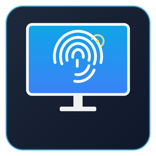

<p align="center">
  
</p>

<h1 align="center">TouchScreen Monitor Selector</h1>

<p align="center">
  Herramienta ligera de escritorio para Windows que permite vincular cualquier digitalizador táctil (HID) a un monitor específico con un solo clic.
  <br />
  Desarrollada con <strong>Tauri 2</strong>, <strong>Rust (Win32 API + Registro)</strong>, <strong>React 19</strong> y <strong>Tailwind CSS v4</strong>.
</p>

---

## Características

- **Mapa visual proporcional de pantallas** — Basado en el selector de monitores de `kindleCustomSO`, dibuja la disposición exacta de tus pantallas (`EnumDisplayMonitors` + nombres reales EDID como `LG ULTRAWIDE`, `Display`, etc.) y marca con un icono táctil en qué pantalla está activo el digitalizador.
- **Detección automática de digitalizadores HID** — Consulta las APIs nativas `GetPointerDevices` y `GetRawInputDeviceList` (Usage Page `0x0D`) para listar todas las pantallas táctiles y lápices conectados con su `VID:PID`, número de puntos de contacto y ruta de instancia HID.
- **Opción B: Vinculación directa e instantánea (Win32 + Registro)** — Escribe directamente la asociación `20-\\?\HID#...` → `\\?\DISPLAY#...` en `HKEY_LOCAL_MACHINE\SOFTWARE\Microsoft\Wisp\Pen\Digimon` y emite el broadcast nativo `WM_SETTINGCHANGE` (`"TabletPCDigitizerMappingChanged"`) mediante `SendMessageTimeoutW` para que Windows aplique el cambio al instante sin reiniciar.
  - Incluye **Manifiesto UAC de Administrador** en compilaciones *release* y elevación automática bajo demanda si se ejecuta sin permisos de administrador.
- **Opción A: Lanzadores directos a herramientas nativas de Windows** — Acceso directo sin pasar por el Panel de Control a:
  - `MultiDigiMon.exe -touch` (Asistente oficial de asignación táctil a monitor)
  - `tabcal.exe devicekind=touch` (Herramienta nativa de calibración de precisión de Tablet PC)
- **Interfaz estilo Windows 11 & Bandeja del Sistema** — Barra de título personalizada sin bordes, minimizado a la bandeja del sistema (System Tray), instancia única (`single-instance`) y soporte multi-idioma (**Español**, **Inglés**, **Francés**, **Alemán** y **Japonés**).

---

## Desarrollo y Compilación

```bash
# Instalar dependencias
npm install

# Ejecutar en modo desarrollo
npm run tauri:dev

# Generar ejecutable e instalador con manifiesto UAC de Administrador
npm run tauri:build
```
